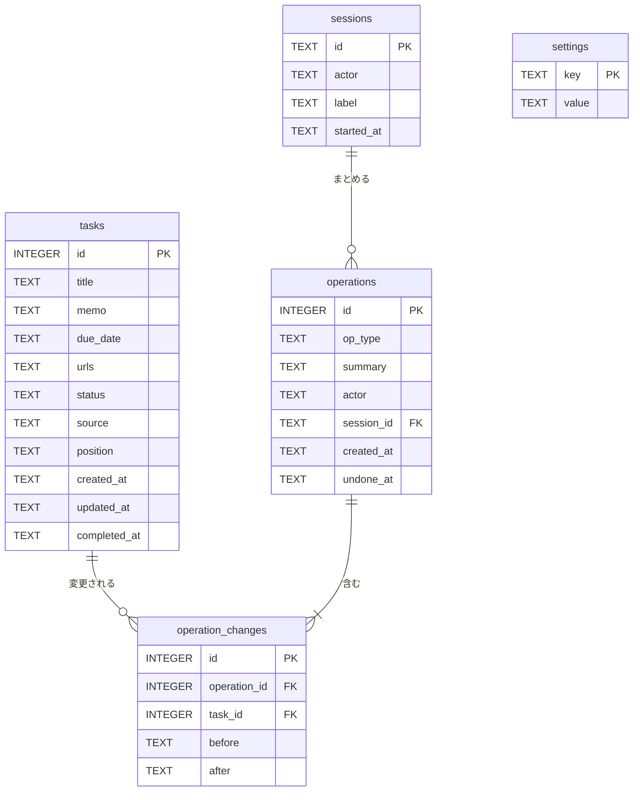
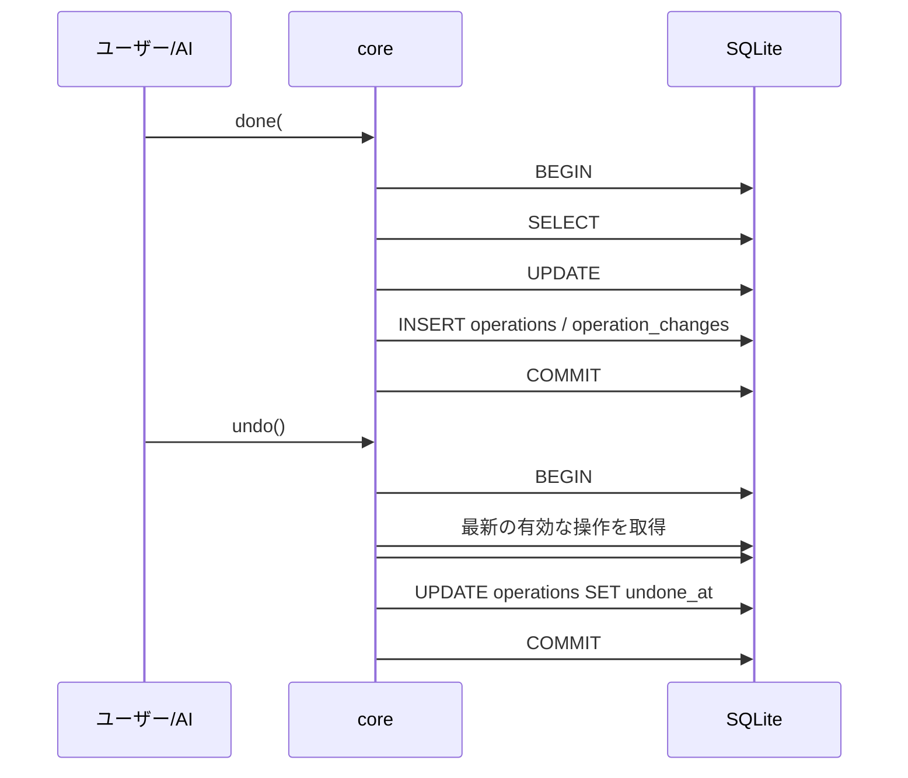

# 技術設計 第1部：DBスキーマとUndo方式

## 1. 全体方針
| 項目 | 採用 | 理由 |
|---|---|---|
| SQLiteライブラリ | `rusqlite`（`bundled` 機能を有効にする） | 同期処理でシンプル。SQLite本体を同梱するので、OSごとの違いを気にしなくてよい |
| マイグレーション | `rusqlite_migration`（`PRAGMA user_version` で管理） | SQLをバイナリに埋め込める。CLIとアプリのどちらから起動しても自動で適用される |
| ジャーナルモード | WAL ＋ `busy_timeout = 5000ms` | アプリとCLIが同時に書き込んでも安全 |
| 日時 | UTCのRFC3339文字列で保存し、表示や月の集計はローカル時刻（JST）に変換する | |
| ID | 整数の連番（表示は `#12`） | CLIで指定しやすい |

## 2. ER図


## 3. DDL（フェーズ1）
```sql
CREATE TABLE tasks (
    id           INTEGER PRIMARY KEY AUTOINCREMENT,
    title        TEXT    NOT NULL CHECK (length(trim(title)) > 0),
    memo         TEXT    NOT NULL DEFAULT '',
    due_date     TEXT,                              -- 'YYYY-MM-DD'
    urls         TEXT    NOT NULL DEFAULT '[]',     -- JSON配列
    status       TEXT    NOT NULL DEFAULT 'queued'
                 CHECK (status IN ('queued','on_hold','done','deleted')),
    source       TEXT    NOT NULL DEFAULT 'manual'
                 CHECK (source IN ('manual','recurring')),
    position     TEXT    NOT NULL,                  -- 並び順のキー（4章）
    created_at   TEXT    NOT NULL,
    updated_at   TEXT    NOT NULL,
    completed_at TEXT
);
CREATE INDEX idx_tasks_status_position ON tasks(status, position);
CREATE INDEX idx_tasks_completed_at    ON tasks(completed_at);

CREATE TABLE sessions (
    id         TEXT PRIMARY KEY,                    -- UUID、またはCLIで指定された文字列
    actor      TEXT NOT NULL CHECK (actor IN ('app','cli','mcp')),
    label      TEXT,                                -- 例："Claude Code 11/18 整理"
    started_at TEXT NOT NULL
);

CREATE TABLE operations (
    id         INTEGER PRIMARY KEY AUTOINCREMENT,
    op_type    TEXT NOT NULL,      -- add / edit / move / done / reopen / hold / resume / delete / restore
    summary    TEXT NOT NULL,      -- 履歴画面に表示する文。例：「#12 見積書作成 を完了」
    actor      TEXT NOT NULL CHECK (actor IN ('app','cli','mcp')),
    session_id TEXT REFERENCES sessions(id),
    created_at TEXT NOT NULL,
    undone_at  TEXT                -- NULL＝有効、値あり＝取り消し済み
);
CREATE INDEX idx_operations_session ON operations(session_id);

CREATE TABLE operation_changes (
    id           INTEGER PRIMARY KEY AUTOINCREMENT,
    operation_id INTEGER NOT NULL REFERENCES operations(id),
    task_id      INTEGER NOT NULL,
    before       TEXT,             -- 変更前のタスク行全体（JSON）。新規作成ならNULL
    after        TEXT NOT NULL     -- 変更後のタスク行全体（JSON）
);
CREATE INDEX idx_changes_operation ON operation_changes(operation_id);
CREATE INDEX idx_changes_task      ON operation_changes(task_id);

CREATE TABLE settings (
    key   TEXT PRIMARY KEY,
    value TEXT NOT NULL            -- JSON
);
```
- **URLはJSON列**にする：別テーブルに分けるより、タスク1行のスナップショットだけでUndoが完結する
- **削除は論理削除**（`status='deleted'`）：物理的に消さないので、Undoが単純になる
- フェーズ2では `recurring_rules`、`company_holidays`、`notification_log` テーブルと、`tasks.recurring_key`（同じ月に二重発行しないためのキー）を追加する

## 4. 並び順：Fractional Indexing
- `position` は辞書順で比較できる文字列キーにする（例：`a0`、`a0V`、`a1`）。2つのタスクの間に移動するときは、その中間のキーを新しく作る
- **移動しても変わるのは対象のタスク1行だけ**なので、Undoの記録が小さく、AIとアプリの操作が衝突しにくい
- 先頭への挿入＝現在の先頭キーより小さいキーを作る
- 実装には `fractional_index` クレートを使う（またはアルゴリズムを自作する）
- 並びは `status` ごとに独立させる（`queued` と `on_hold` は別々の並び）
- **完了の取り消しでは元の位置に戻す**：完了しても `position` は消さずに残しておき、取り消したときは `status` を `queued` に戻すだけにする。前後にあったタスクが残っていれば、元の位置に戻る（キーが重複した場合は `id` 順で並べる）

## 5. Undo / Redo の方式

### 5.1 基本：スナップショット方式
- 変更操作は、すべて core の `apply(op)` を通す。1回のトランザクションで次の3つを行う
  1. タスクの変更前の状態を読む
  2. 変更を適用する
  3. `operations` と `operation_changes`（変更前後のスナップショット）を記録する
- 取り消すときは `before` を書き戻し、`undone_at` を記録する（`before` がNULLの場合は、作成を取り消すために `deleted` にする）。やり直すときは `after` を書き戻す
- 取り消し済みの操作は、履歴画面に取り消し線つきで残す

### 5.2 人間のUndoとAIのロールバックを分ける
| | **Undo（人間用）** | **ロールバック（AI用）** |
|---|---|---|
| 対象 | 操作者が `app` の操作だけ | 操作者が `cli` / `mcp` の操作。セッション単位 |
| 呼び出し方 | アプリの `Cmd+Z` / `Cmd+Shift+Z` | 履歴画面の「このセッションを巻き戻す」、`dan rollback [--session <id>]` |
| 粒度 | 1操作ずつ（Redoもできる） | セッションに含まれる操作をまとめて |
| 補足 | AIの操作には一切影響しない | AI自身がCLIで `dan undo` を実行した場合は、自分のセッションの直前の操作を1つ戻す |

- 人間のUndoスタックとAIのセッションは独立しているので、**「`Cmd+Z` を押したらAIの作業が消えた」ということは起きない**
- 新しい操作をすると、**同じ範囲（人間／そのセッション）のRedoは無効**になる

### 5.3 範囲を分けたことで必要になる競合チェック
- 範囲を分けると、「人間の操作の後にAIが同じタスクを変更した」という状況が起こりうる。このとき人間の操作をそのまま書き戻すと、AIの変更を消してしまう
- そのため、**取り消す前に必ず次の条件を確認する**（どの種類の取り消しでも同じルール）
  - 取り消し：対象タスクの現在の状態が、その操作の `after` と一致すること
  - やり直し：対象タスクの現在の状態が、その操作の `before` と一致すること
- 一致しない場合
  - **Undo**：取り消さず、トーストで知らせる（例：「#12 はAIが後から変更したため取り消せません」）
  - **ロールバック**：競合しているタスクを一覧で示し、①競合しているタスクを除いて戻す、②中止、から選ばせる
- 比較の対象は `updated_at` を除いた業務上の項目だけにする



### 5.4 非常用：任意の時点まで戻す
- 履歴画面で操作を1つ選び、「この時点まで戻す」を実行すると、それより後の有効な操作を、**操作者に関係なく**新しい順にすべて取り消す
- 新しいものから順に戻していくので、競合は起きない。実行前に確認ダイアログを出す

### 5.5 セッションIDの決め方
| 入り口 | セッション |
|---|---|
| アプリ | 起動ごとに1セッション（操作者 `app`） |
| CLI | 次の優先順で決める：① `--session <id>` → ② 環境変数 `DANDORI_SESSION` → ③ **アクティブセッション**（`dan session start` で開始し、`dan session end` で終了するまで、または最後の操作から30分経つまで有効）→ ④ 1コマンドを1セッションとする |
| MCP（フェーズ2） | 1接続を1セッションとする |

> Claude Code の Bash ツールは、コマンドごとに環境変数が引き継がれないことがある。そのため ③ のアクティブセッション（DBの `settings` テーブルに保存する）を基本の運用とする。詳しくは [design-02-cli.md](design-02-cli.md) を参照

## 6. CLIの変更をアプリに反映する
- アプリは `PRAGMA data_version` を **500msごとにポーリング**する。値が変わったら（＝別の接続から書き込まれたら）、データを再取得して画面を更新する
- 負荷はごくわずか。ファイル監視より確実で、OSごとの違いもない

## 7. 保存場所とバックアップ
| 項目 | 内容 |
|---|---|
| DBの場所 | macOS：`~/Library/Application Support/Dandori/dandori.db`<br>Windows：`%APPDATA%\Dandori\dandori.db` |
| 場所の変更 | 環境変数 `DANDORI_DB` で変更できる（テストや開発用）。アプリとCLIは同じ解決ロジックを使う |
| バックアップ | アプリの起動時と、その後24時間ごとに `VACUUM INTO 'backups/dandori-YYYYMMDD-HHMM.db'` を実行する |
| 世代 | 直近30世代を残す |
| 履歴の肥大化 | 個人用途なら10年分でも数十MB程度なので、当面は削除しない（将来、古い操作ログを整理するコマンドを用意してもよい） |

## 8. coreの公開API（イメージ）
```rust
pub struct Store { /* rusqlite::Connection */ }

impl Store {
    pub fn open(path: &Path) -> Result<Self>;            // マイグレーションも行う
    // 参照
    pub fn list(&self, status: Status) -> Result<Vec<Task>>;
    pub fn get(&self, id: TaskId) -> Result<Task>;
    pub fn search(&self, q: &str) -> Result<Vec<Task>>;
    pub fn history(&self, limit: usize) -> Result<Vec<Operation>>;
    pub fn report(&self, month: YearMonth, include_recurring: bool) -> Result<Vec<Task>>;
    // 変更（すべて操作ログが記録される）
    pub fn add(&mut self, ctx: &Ctx, new: NewTask, at: InsertAt) -> Result<Task>;
    pub fn edit(&mut self, ctx: &Ctx, id: TaskId, patch: TaskPatch) -> Result<Task>;
    pub fn move_to(&mut self, ctx: &Ctx, id: TaskId, at: InsertAt) -> Result<()>;
    pub fn set_status(&mut self, ctx: &Ctx, id: TaskId, s: Status) -> Result<()>;
    // 取り消し
    pub fn undo(&mut self, ctx: &Ctx, scope: Scope) -> Result<UndoResult>;   // Scope::Human / Scope::Session(id)
    pub fn redo(&mut self, ctx: &Ctx, scope: Scope) -> Result<UndoResult>;
    pub fn rollback_session(&mut self, ctx: &Ctx, sid: &str, mode: ConflictMode) -> Result<UndoResult>;
    pub fn restore_to(&mut self, ctx: &Ctx, op_id: OpId) -> Result<Vec<Operation>>;
}

pub struct Ctx { pub actor: Actor, pub session_id: String }
pub enum InsertAt { Top, Bottom, Before(TaskId), After(TaskId) }
```

## 9. 決定事項・確認事項
- **D1** アプリ名は **Dandori**、CLIのコマンド名は **`dan`**：決定
- **D2** 人間のUndoとAIのロールバックを分ける（5.2）：決定
- **D3** 完了を取り消したタスクは元の位置に戻す（4章）：決定
