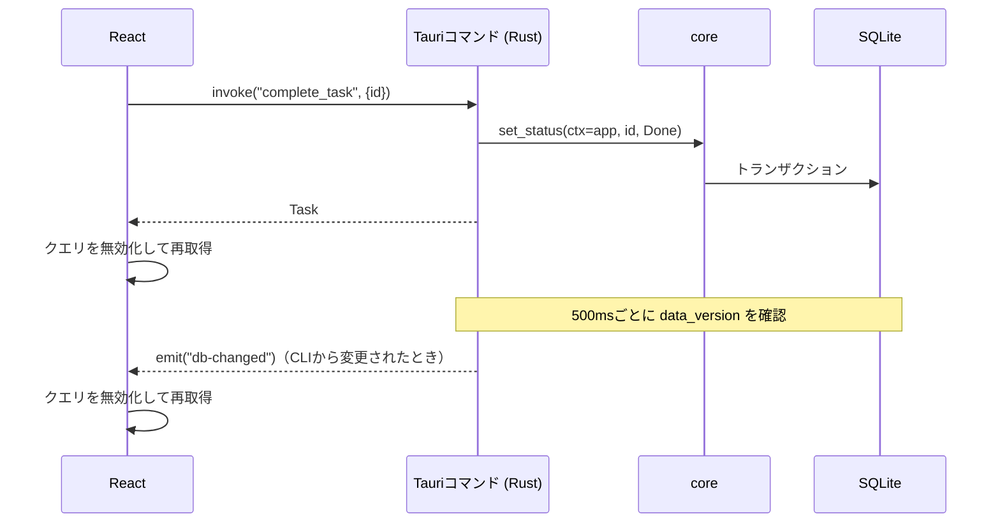

# 技術設計 第3部：画面設計

> 触って確認できるプロトタイプ：[prototype.html](prototype.html)
> （追加、完了、ドラッグでの並べ替え、詳細パネル、⌘Z でのUndo、履歴、設定を試せます。データはダミーです）

## 1. 画面一覧
| 画面 | 内容 |
|---|---|
| **キュー**（メイン） | 「今やること」カード、追加フォーム、次以降のリスト、保留セクション |
| **詳細パネル** | キュー画面の右側に開く。タイトル、期限、URL、メモ（編集と表示を切り替え）、完了・保留・削除 |
| **完了済み** | 完了したタスクと削除したタスクを、切り替えて一覧表示する。誤って完了・削除したタスクを元に戻すための画面 |
| **履歴** | 操作の一覧。AIの操作はセッションごとに折りたたみ、「このセッションを巻き戻す」ボタンを付ける |
| **設定** | 文字サイズ、データの場所、バックアップ、CLIのインストール（フェーズ2で定期タスク・休日・通知の設定を追加） |

ウィンドウの推奨サイズは 900×640、最小幅は 720px。詳細パネルは右側に固定する（ウィンドウの幅が狭いときは上に重ねて表示する）。

## 2. キュー画面
```
┌──────────────────────────────────────────────┐
│ Dandori                   [キュー] 履歴  設定 │
├──────────────────────────────────────────────┤
│ 今やること                                     │
│ ┌──────────────────────────────────────────┐ │
│ │ ○  見積書を作成して送付                    │ │
│ │    [11/20まで] 🔗 example.com/board/123    │ │
│ │    ─────────────────────                  │ │
│ │    メモ（Markdownをレンダリング）           │ │
│ │    [完了] [保留] [詳細]                     │ │
│ └──────────────────────────────────────────┘ │
│ ＋ タスクを追加…           [末尾に追加 ▾] ⌘N  │
│ 次以降                                   4件  │
│ ⋮⋮ 2 ○ PRレビュー                     🔗2    │
│ ⋮⋮ 3 ○ 経費精算              [11/17 期限切れ] │
│ ⋮⋮ 4 ○ 週次レポート              [今日まで]   │
│ ▸ 保留中 (1)                                  │
└──────────────────────────────────────────────┘
```
| 要素 | 仕様 |
|---|---|
| 今やることカード | 先頭のタスクを大きく表示する。メモがあれば展開して表示する。完了すると次のタスクが繰り上がる（短いアニメーションを付ける） |
| 追加フォーム | Enterで追加する。追加先はドロップダウンで選ぶ（末尾＝デフォルト／先頭／n番目）。前回選んだ値は覚えずに、毎回末尾に戻す |
| リスト | ⋮⋮ をドラッグして並べ替える。番号はキューの中の位置（CLIの `@n` と対応）。期限、URLの件数、メモの有無をアイコンで示す |
| 期限の表示 | 期限切れ＝赤、今日まで＝オレンジ、それ以外＝グレー。色だけに頼らず、文字（「期限切れ」「今日まで」）も添える |
| 右クリックメニュー | 先頭へ移動、末尾へ移動、保留、削除 |
| 保留セクション | デフォルトでは折りたたむ。「キューに戻す」で末尾に戻す |
| 空の状態 | 「キューは空です」と表示する |

## 3. 詳細パネル
- 入力欄はその場で編集できる。フォーカスが外れたとき（タイトル）や値が確定したとき（期限、URL）に保存し、1回の保存を1操作として記録する
- メモは「表示」（レンダリング）をデフォルトにし、「編集」タブでMarkdownを書く。編集中は `Cmd/Ctrl+Enter` か「表示」への切り替えで保存する
- URLは貼り付けてEnterで追加する。クリックすると既定のブラウザで開く（Tauriの opener プラグインを使う）
- 削除ボタンは右端に離して置き、赤字で表示する。確認ダイアログは出さず、トーストの「元に戻す」で戻せるようにする

## 4. 操作のフィードバック
- 変更操作のたびに、画面下部にトーストを出す（例：「『経費精算』を完了しました ［元に戻す ⌘Z］」）。4秒で消える
- CLIからの変更が反映されたときは、トーストは出さない。代わりに、変更された行を一瞬ハイライトする
- 人間のUndoが競合で失敗したときは、「#12 はAIが後から変更したため取り消せません」とトーストで知らせる

## 5. 完了済み画面
- ナビゲーションの並び：キュー ／ **完了済み** ／ 履歴 ／ 設定（使う頻度が低いので、メインのキューからは1クリック離れた位置に置く）
- 上部の切り替えボタンで「完了」と「削除済み」を切り替える
- 月ごとにまとめて、新しい順に表示する（見出し例：「2026年11月 3件」）
- 各行：タイトル、完了日（または削除日）、定期タスクの印、操作ボタン
  - 完了：［未完了に戻す］→ キューの元の位置に戻す
  - 削除済み：［復元］→ キューの元の位置に戻す
- タイトルとメモを検索できる
- 行をクリックすると詳細パネルを開く（閲覧専用）
- Undoとの違い：Undoは直前の操作を順番に戻すもの。この画面では、**時間が経ってからでも、特定の1件だけを狙って戻せる**。戻す操作も1操作として記録されるので、さらにUndoもできる

## 6. 履歴画面
- 新しい順に、日付ごとに区切って表示する
- 自分の操作：1行に1操作（［自分］ 内容 時刻）。小さく「この時点まで戻す」リンクを付ける（非常用。実行前に確認ダイアログを出す）
- AIの操作：セッション単位のカード（［AI］ ラベル 時刻・件数 ［このセッションを巻き戻す］）。その中に操作を一覧表示する
- 取り消し済みの操作には取り消し線を引く

## 7. 見た目のルール
| 項目 | 値 |
|---|---|
| 背景 | `#F6F5F1`（少し温かみのあるオフホワイト） |
| カード | `#FFFFFF`、枠線 `#E2E0DA` |
| 本文 | `#262626`（純黒にはしない） |
| 補助テキスト | `#5A5A5A`（白の上でコントラスト比 約6.9:1、AAを満たす） |
| アクセント | `#2E56C7`（落ち着いた青） |
| 警告 | 赤 `#B42318`、オレンジ `#9A5B00`（どちらも淡い背景色とセットで使う） |
| フォント | OS標準（macOS：ヒラギノ角ゴ / SF、Windows：Yu Gothic UI / Segoe UI）。ウェイトは400・500・600のみ使う |
| 文字サイズ | 本文15px（小14／中15／大17／特大19）。12px未満は使わない |
| 行間 | 1.7 |
| 角丸 | カード12px、ボタン6px |

## 8. フロントエンドの技術構成
| 用途 | 採用 |
|---|---|
| ビルド | Vite + React + TypeScript |
| スタイル | Tailwind CSS |
| UI部品 | shadcn/ui（Radixベース。ダイアログ、ドロップダウン、トースト、右クリックメニューなど） |
| 並べ替え | dnd-kit |
| Markdownの表示 | react-markdown + remark-gfm |
| メモの編集 | フェーズ1は `textarea`（必要になったら CodeMirror に置き換える） |
| サーバー状態の管理 | TanStack Query（Tauriのコマンドを呼んでキャッシュする） |
| ショートカット | 自前の小さなフック（入力中かどうかで `Cmd+Z` の動作を切り替える） |

### Tauriとのつなぎ方

- Tauriコマンドは core の関数を薄く包むだけにする
- 型は `ts-rs` か `specta` でRustからTypeScriptへ自動生成し、両者の食い違いを防ぐ

## 9. 決定事項
- **U1** 全体の雰囲気はプロトタイプのとおりとする
- **U2** 「今やること」カードにはメモも展開して表示する
- **U3** 「完了済み」画面を追加する（5章）。削除済みのタスクもここから復元できる
