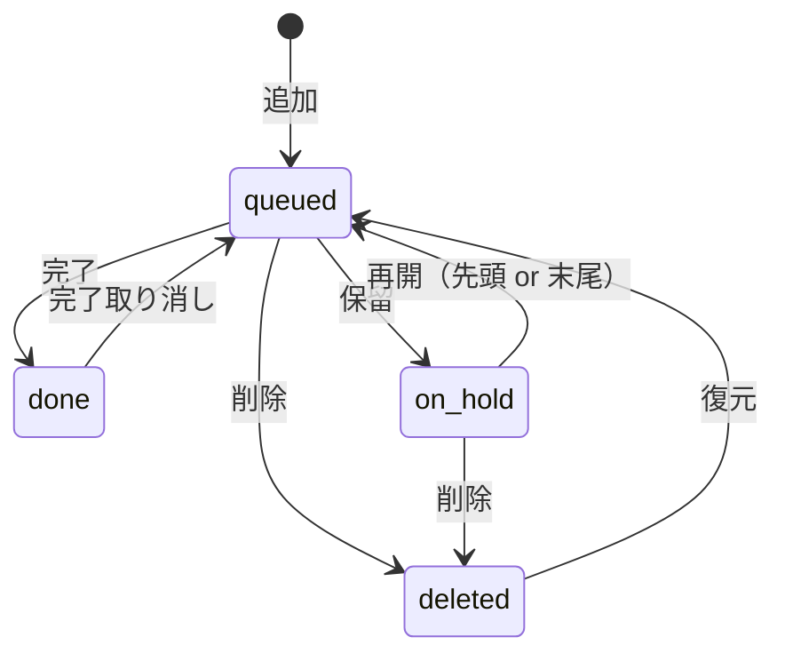
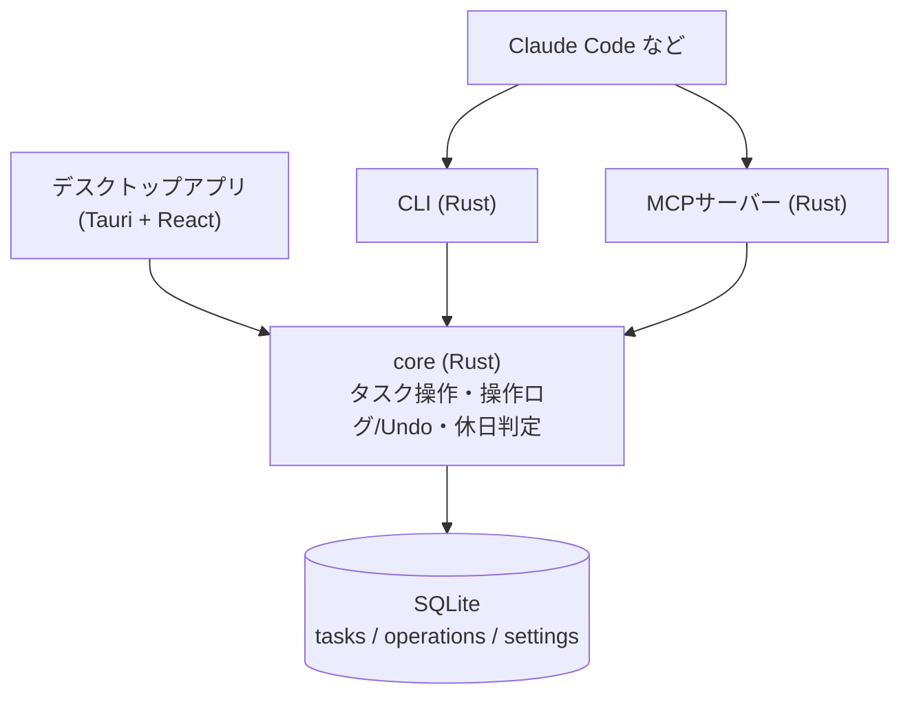

# Dandori 要件定義（v0.5）

## 1. コンセプト
仕事専用の**個人用シングルタスク・キュー**。
マルチタスクを避け、「今やること」を1つに絞って上から片付ける。
未着手タスクの管理はチームのカンバンに任せ、本アプリは「自分が手をつけるもの」だけを扱う。
UIは「Todoist の Inbox だけを使う」イメージ。

## 2. 非機能要件
| 項目 | 要件 |
|---|---|
| 動作環境 | macOS（主）、Windows（動作確認用） |
| ネットワーク | 完全ローカルで動作。外部サービスには依存しない |
| データ原本 | **SQLite**（1ファイル）。AIはCLI・MCP経由で操作する |
| 整合性 | すべての書き込みをトランザクションで行う。アプリとCLIが同時にアクセスしても壊れないこと（WALモード） |
| 履歴 | 操作ログを保存し、Undo・Redo・任意時点への復元ができること（3.7） |
| 外部からの変更 | アプリ起動中にCLIやMCPからデータが変更されたら、画面に自動で反映されること |
| バックアップ | DBファイルを定期的に自動バックアップする（世代管理） |
| 常駐 | 通知を出すため、メニューバーやタスクトレイに常駐すること（フェーズ2） |
| 見やすさ | ライトモードのみ。十分なコントラスト、細すぎないフォント、文字サイズの変更（4.2） |
| 技術 | Tauri（Rust）＋ React（TypeScript） |

## 3. 機能要件

### 3.1 キュー
- キューは1本のみ。プロジェクトやフォルダの階層は持たない
- 先頭のタスクを「今やること」として強調表示する
- 任意の位置に挿入・並べ替えができる（ドラッグ＆ドロップ、または位置を指定して挿入）。新規タスクは**デフォルトで末尾**に入れる（定期タスクは先頭）
- 完了すると次のタスクが繰り上がる

### 3.2 タスクの属性
| 属性 | 入力 | 備考 |
|---|---|---|
| ID | 自動 | CLIで指定しやすい短いID |
| タイトル | 必須 | |
| メモ | 任意 | Markdown。画面上ではレンダリングして表示する |
| 期限 | 任意 | 日付のみ。期限切れや当日のものは強調表示する |
| URL | 任意 | 複数登録できる。クリックするとブラウザで開く |
| 作成日時／完了日時 | 自動 | |
| 種別 | 自動 | `manual`（手動で作成）／`recurring`（定期タスクから発行） |
| 状態 | 自動 | `queued`（キュー）／`on_hold`（保留）／`done`（完了）／`deleted`（削除） |

### 3.3 タスクの状態と操作

- 削除は論理削除とする。キュー画面には表示しないが、Undoや「完了済み」画面から復元できる
- 完了の取り消しと復元では、キューの元の位置に戻す

### 3.4 定期タスク（フェーズ2）
- 周期は「毎月の最終営業日」のみ
- 営業日は土日・日本の祝日・会社休日を除いて判定する
- 当日の昼頃に自動で発行し、キューの先頭に入れる。発行時には通知しない
- 当日の18時の時点で未完了なら通知する
- アプリが停止していて発行時刻を過ぎた場合は、次に起動したときに発行する

### 3.5 休日設定（フェーズ2）
- 日本の祝日：アプリが判定する
- 会社休日：設定画面またはCLIで登録する（毎年同じ日／その年だけの日）

### 3.6 振り返り
- `dan report --month 2026-11` で、その月の完了タスクをMarkdownとして出力する
  - 種別 `recurring` のタスクは、デフォルトで除外する（オプションで含められる）
- 出力をAIに読ませて要約させる前提とし、アプリ自体には集計・分析の機能を持たせない

### 3.7 履歴・Undo
- すべての変更操作を、操作ログとして記録する
  - 記録する項目：操作の種類、対象のタスク、変更前後の状態、日時、操作者（`app` / `cli` / `mcp`）、セッションID
- Undoは2種類用意する
  - **1つ戻す／やり直す**（Undo / Redo）
  - **まとめて戻す**：AIのセッション単位、または履歴上の任意の時点まで戻す
- セッション
  - CLI：環境変数またはオプションでセッションIDを指定する
  - MCP：1接続を1セッションとして扱う
- 履歴画面では、操作の概要（内容、日時、操作者）を一覧表示する。差分は表示しない

### 3.8 AI連携
- CLI（フェーズ1）：`dan add / list / show / edit / done / hold / resume / delete / move / undo / redo / history / report`
  - 出力形式：人が読むためのテキストと、`--json`（AIやスクリプト向け）の両方を用意する
- MCPサーバー（フェーズ2）：CLIと同じ操作を提供する
- AI向けの使い方ガイド（例：`CLAUDE.md` に貼れるCLIの使い方）を用意する

## 4. UI

### 4.1 画面構成
- 1画面で完結させる
  - 上部に「今やること」（先頭タスク）を大きく表示する
  - その下に残りのキューを並べる
  - 保留中のタスクは折りたたみセクションに表示する
- タスクをクリックすると詳細パネルが開き、メモ・期限・URLを編集できる
- 履歴画面と設定画面は別に用意する
- 「完了済み」画面を用意し、完了したタスクと削除したタスクを確認・復元できるようにする

### 4.2 見やすさ
- ライトモードのみ（ダークモードは作らない）
- やや落ち着いた白の背景＋濃いグレーの文字にし、ギラつきを抑えつつコントラストは十分に確保する（WCAG AA 以上）
- 細いフォント（weight 300以下）は使わない。行間を広めにとる
- 文字サイズを設定で変更できる

### 4.3 キーボードショートカット
| 操作 | macOS | Windows |
|---|---|---|
| タスクを追加 | `Cmd+N` | `Ctrl+N` |
| 入力を確定／キャンセル | `Enter` / `Esc` | 同左 |
| メモの改行 | `Shift+Enter` | 同左 |
| Undo／Redo | `Cmd+Z` / `Cmd+Shift+Z` | `Ctrl+Z` / `Ctrl+Y` |
| 検索 | `Cmd+F` | `Ctrl+F` |
| 設定 | `Cmd+,` | `Ctrl+,` |
| 文字サイズ | `Cmd + +/-/0` | `Ctrl + +/-/0` |
| アプリを呼び出す（フェーズ2、任意） | `Cmd+Shift+Space` | `Ctrl+Shift+Space` |

> テキスト入力中の `Cmd/Ctrl+Z` は入力欄の取り消し、それ以外では操作のUndoとして扱う

## 5. アーキテクチャ

- ロジックを `core` に集約し、アプリ・CLI・MCPは入り口にすぎない構成にする
- Cargo workspace の1つのリポジトリで管理する

## 6. リリース計画
| フェーズ | 範囲 |
|---|---|
| **1（MVP）** | キュー操作、タスクの属性、完了・保留・削除、操作ログ・Undo/Redo、履歴画面、CLI（`report` を含む）、UI一式、自動バックアップ |
| **2** | 定期タスク、休日設定、通知、常駐、MCPサーバー、全体ホットキー |

## 7. 技術設計で決めること
- DBスキーマ（tasks / operations / settings）とマイグレーション方式
- Undoの実装方式（変更前後の状態を保存する方式を想定）
- CLIからの変更をアプリに反映する方法（SQLiteの変更検知またはポーリング）
- 並べ替え順序の持ち方
- DBファイルとバックアップの保存場所（OSごとのアプリデータフォルダ。設定で変更できるか）
- UIライブラリ（Tailwind CSS、shadcn/ui など）
